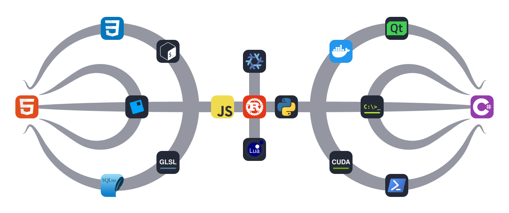
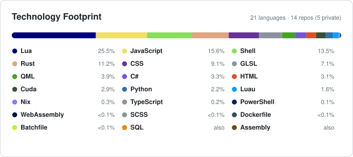

  

   
I'm Chrome. Welcome to the repo. I'm just trying to keep myself busy and learn new skills. If you find something you like, star it. If not, keep it pushin.

<h1 align="center">NixOS | Rust | Neovim | Full stack</h1>

###

 

  <picture>
    <source media="(prefers-color-scheme: dark)" srcset="./assets/languages-dark.svg">
    
  </picture>

 

  <picture>
    <source media="(prefers-color-scheme: dark)" srcset="https://raw.githubusercontent.com/m4c4r0n1n/m4c4r0n1n/footprint/footprint-dark.svg">
    
  </picture>

###

 

<picture>
  <source media="(prefers-color-scheme: dark)" srcset="https://raw.githubusercontent.com/m4c4r0n1n/m4c4r0n1n/output/pacman-contribution-graph-dark.svg">
  <source media="(prefers-color-scheme: light)" srcset="https://raw.githubusercontent.com/m4c4r0n1n/m4c4r0n1n/output/pacman-contribution-graph.svg">
  
</picture>

###
<h2 align="center">Sup</h2>

  

<h2 align="center">HELL YEAH I STOLE THIS, HELL NO THESE NUMBERS DON'T MEAN SHIT.</h2>
